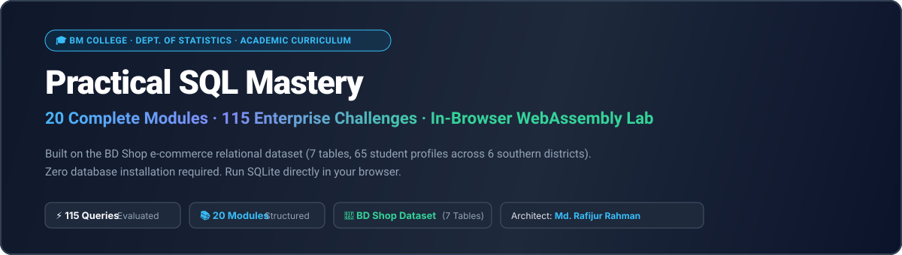
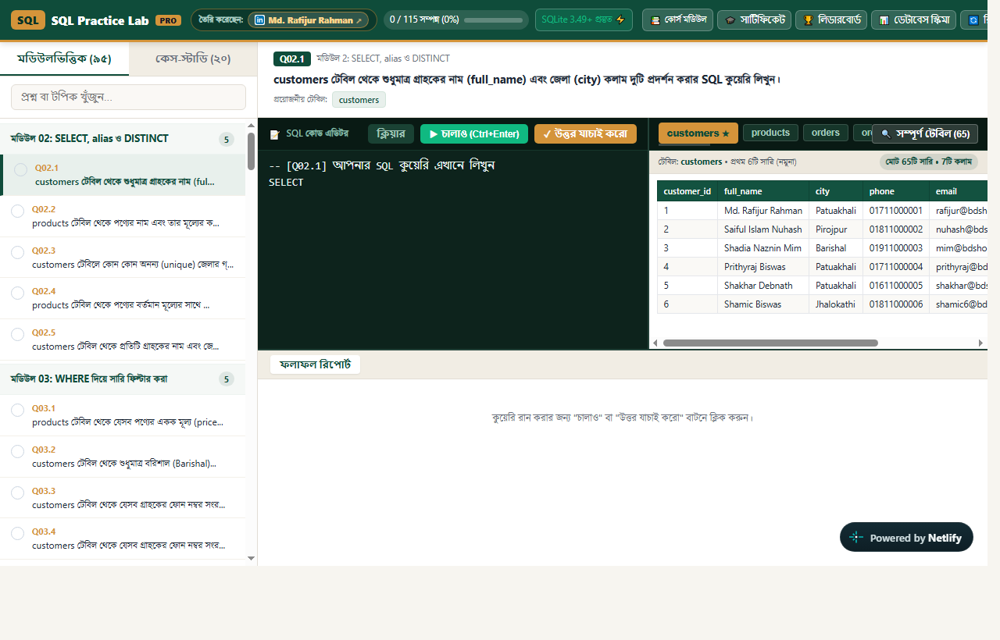
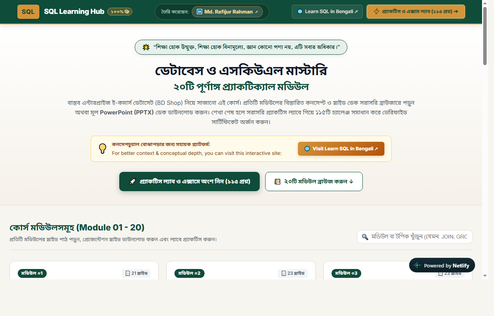
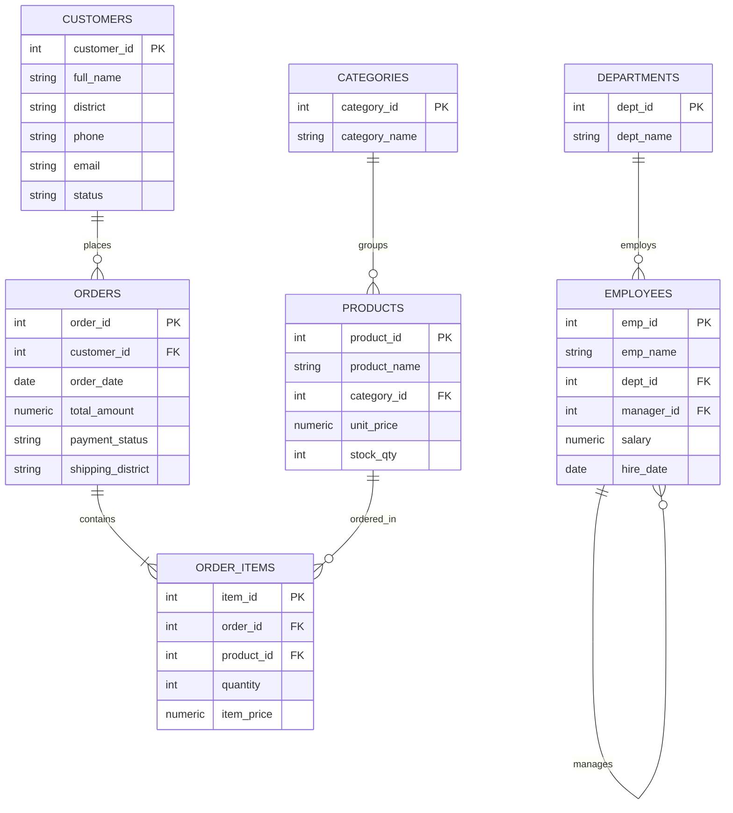

<p align="center">
  
</p>

<p align="center">
  <a href="https://sql-practice-lab.netlify.app/"></a>
  <a href="https://sql-learning-hub.netlify.app/"></a>
  <a href="#database-schema--er-diagram"></a>
  <a href="#challenge-sets-115-enterprise-queries"></a>
  <a href="https://www.linkedin.com/in/mdrafijur"></a>
</p>

---

## 🌐 Cloud Companions (No Database Installation Required)

To make learning friction-free, I built and deployed two companion web applications. Students run real queries in their browser without setting up local database servers or dealing with broken configurations:

<table>
  <tr>
    <td width="50%" align="center" valign="top">
      <h3>⚡ SQL Practice Lab</h3>
      <p><b>In-browser SQLite WebAssembly IDE</b></p>
      <p>Solve 115 enterprise challenges with automated real-time query validation, schema viewer, and cloud progress tracking.</p>
      <a href="https://sql-practice-lab.netlify.app/">
        
      </a>
      <br><br>
      <a href="https://sql-practice-lab.netlify.app/">
        
      </a>
    </td>
    <td width="50%" align="center" valign="top">
      <h3>📚 SQL Learning Hub</h3>
      <p><b>Curriculum Portal & Slide Viewer</b></p>
      <p>Module-by-module slide reader, query syntax breakdowns, execution order diagrams, and realistic business reports.</p>
      <a href="https://sql-learning-hub.netlify.app/">
        
      </a>
      <br><br>
      <a href="https://sql-learning-hub.netlify.app/">
        
      </a>
    </td>
  </tr>
</table>

---

## 🎯 The Origin Story: Why I Built This

When I started teaching SQL to junior university students at Government Brojomohun College (BM College), I ran straight into two painful patterns.

The first was the **installation trap**. Half the class spent their first three lab sessions wrestling with MySQL installer crashes, forgotten root passwords, and port 3306 permission conflicts. By the time their local database engine responded, their motivation had died.

The second was the **toy problem trap**. Generic online tutorials rely on abstract tables like `TableA (id, val)` and ask students to find the second highest salary. In actual company databases, data is messy. Customers duplicate accounts across different phone numbers. Orders get cancelled halfway through payment, leaving orphaned records that break naive joins. Dates arrive in irregular timestamp formats.

I built this curriculum to fix both problems:
1. **Zero Setup Barrier:** Students start querying on day one using the in-browser WebAssembly lab.
2. **Messy, Localized Data:** Every single query runs against **BD Shop** (`bdshop.db`), an authentic 7-table relational dataset containing 65 localized student profiles from 6 southern districts of Bangladesh, real order flows, product catalogs, and managerial hierarchies.

Students learn relational logic on data that mirrors a living business.

---

## 🗄️ Database Schema & ER Diagram

The **BD Shop** database contains 7 relational tables with authentic foreign key relationships, missing data edge cases, and self-referencing managerial hierarchies:



---

## 🗺️ 20-Module Curriculum Roadmap

The curriculum progresses systematically from baseline data retrieval to advanced analytical window functions and database modeling:

| Module | Core Topic | Key SQL Concepts & Clauses | Challenges |
| :---: | :--- | :--- | :---: |
| **01** | Database & SQL Foundations | RDBMS concepts, tables, primary keys, SQLite 3.30 baseline | Concept |
| **02** | SELECT, Alias & DISTINCT | Projection, readable column aliasing, duplicate suppression | 5 Queries |
| **03** | WHERE Clause & Filtering | Exact matching, relational operators, AND / OR compound logic | 5 Queries |
| **04** | Advanced Filtering & Sorting | IN, BETWEEN, LIKE wildcards, ORDER BY, LIMIT, OFFSET | 5 Queries |
| **05** | DDL & DML Operations | CREATE TABLE, constraints, INSERT, UPDATE, DELETE, transactions | 5 Queries |
| **06** | Aggregate Functions & GROUP BY | COUNT, SUM, AVG, MIN, MAX, grouping aggregations | 5 Queries |
| **07** | HAVING & Execution Order | Post-aggregation filtering, FROM-to-LIMIT execution pipeline | 5 Queries |
| **08** | Conditional & Coercion Functions | CASE WHEN expressions, COALESCE, NULLIF, CAST conversions | 5 Queries |
| **09** | INNER JOIN & Relationships | Foreign keys, ER mapping, multi-table relationship queries | 5 Queries |
| **10** | LEFT JOIN & Anti-Join | Preserving unmatched rows, finding churned customers via IS NULL | 5 Queries |
| **11** | SELF JOIN & CROSS JOIN | Hierarchical manager trees, Cartesian pairing comparisons | 5 Queries |
| **12** | Set Operators | UNION, UNION ALL, INTERSECT, EXCEPT set operations | 5 Queries |
| **13** | String & Numeric Functions | UPPER, LOWER, TRIM, SUBSTR, LENGTH, INSTR, ROUND | 5 Queries |
| **14** | Date & Time Analysis | DATE, STRFTIME, timestamp parsing, monthly cohort extraction | 5 Queries |
| **15** | Subqueries & EXISTS | Correlated subqueries, scalar subqueries, EXISTS vs IN indexing | 5 Queries |
| **16** | Common Table Expressions (CTE) | Multi-step reporting pipelines with WITH syntax, recursive CTEs | 5 Queries |
| **17** | Window Functions (Rankings) | OVER (PARTITION BY ... ORDER BY), ROW_NUMBER, RANK, DENSE_RANK | 5 Queries |
| **18** | Window Functions (Offsets & Totals) | LAG, LEAD period differences, rolling cumulative running sums | 5 Queries |
| **19** | Indexing, Query Plans & Modeling | EXPLAIN QUERY PLAN, B-Tree indexes, normal forms (1NF to 3NF) | 5 Queries |
| **20** | BD Shop Capstone Project | End-to-end business reporting, customer lifetime value analysis | 5 Queries |

---

## 🏆 Challenge Sets: 115 Enterprise Queries

The curriculum includes **115 practical business problems** split into two targeted tracks:

1. **95 Module-Wise Practice Questions:** Five focused questions per module (Modules 02 to 20) that isolate and test syntax immediately after learning the lesson.
2. **20 Milestone Enterprise Scenarios:** Four deep-dive business case studies after every four modules:
   * **Milestone 1 (Modules 01-04):** Customer demographics, order volume, and district order value analysis.
   * **Milestone 2 (Modules 05-08):** Revenue leakage detection, missing contact numbers, and payment status audits.
   * **Milestone 3 (Modules 09-12):** Multi-table fulfillment gaps, product stock depletion, and anti-join customer retention.
   * **Milestone 4 (Modules 13-16):** Month-over-month growth, purchase frequency intervals, and CTE reporting pipelines.
   * **Milestone 5 (Modules 17-20):** Customer lifetime value (LTV), top spenders by district, and RFM customer segmentation.

---

## 📂 Repository Directory Layout

```text
practical-sql-mastery/
├── assets/                            # Visual banners and platform preview screenshots
│   ├── hero_banner.svg                # Master curriculum vector banner
│   ├── practice_lab_preview.png       # Live SQL Practice Lab interface snapshot
│   └── learning_hub_preview.png       # Live SQL Learning Hub portal snapshot
├── 01_Database_and_Datasets/          # The BD Shop relational database and schemas
│   ├── bdshop.db                      # Ready-to-use SQLite database file (7 tables)
│   ├── bdshop_full.sql                # Complete schema and dataset insert script
│   ├── bdshop_lite.sql                # Lightweight version for quick testing
│   ├── db_fiddle_schema.txt           # Pre-formatted schema for online DB Fiddle
│   └── README_DATASET.md              # Detailed schema map, table roster, and student profiles
├── 02_Student_Practice_SQL/           # Individual setup scripts for modules 01 to 20
├── 03_Questions/                      # Student question sets (PDF and plain text)
│   ├── 01_Module_Wise_Questions/      # 95 module-level questions (STUDENT_QUESTIONS.pdf)
│   └── 02_Milestone_Case_Studies/     # 20 milestone case studies (MILESTONE_CASE_STUDIES.pdf)
├── 04_Solutions/                      # Instructor solutions and query explanations
│   ├── 01_Module_Wise_Solutions/      # Complete solutions for all 95 module questions
│   └── 02_Milestone_Case_Studies_Solutions/ # Complete solutions for all 20 milestone scenarios
├── 05_Lab_Cheat_Sheet/                # Classroom reference cheat sheet
│   ├── SQL_LAB_CHEAT_SHEET.pdf        # Print-ready 2-page color-coded cheat sheet (Kalpurush font)
│   └── SQL_LAB_CHEAT_SHEET.txt        # Plain-text quick reference
└── README.md                          # Master curriculum guide and index
```

---

## 🚀 How to Practice

### Option A: In-Browser (Instant, Zero Setup)
1. Launch the **[SQL Practice Lab](https://sql-practice-lab.netlify.app/)**.
2. Select any module from 02 to 20.
3. Write your query in the code editor and hit **Run Query (Ctrl + Enter)**.
4. The WebAssembly engine validates your output table against the expected result instantly.

### Option B: Offline Desktop (DB Browser for SQLite)
1. Download `01_Database_and_Datasets/bdshop.db` from this repository.
2. Open it in **[DB Browser for SQLite](https://sqlitebrowser.org/)** (available for Windows, Mac, and Linux).
3. Navigate to the **Execute SQL** tab and write your queries directly against the local database file.

---

## 👨‍🏫 Author & Community Dedication

**Md. Rafijur Rahman (Zuboraj)**  
*Department of Statistics, Government Brojomohun College (BM College), Barishal*  
*Portfolio & Connect:* [linkedin.com/in/mdrafijur](https://www.linkedin.com/in/mdrafijur)

> *"শিক্ষা হোক উন্মুক্ত, শিক্ষা হোক বিনামূল্যে, জ্ঞান কোনো পণ্য নয়, এটি সবার অধিকার।"*  
> *(Education should be open, education should be free; knowledge is not a commodity, it is everyone's right.)*

If you find this curriculum helpful for your university labs, personal learning, or teaching, please consider giving it a **Star ⭐** to help other students find it.
